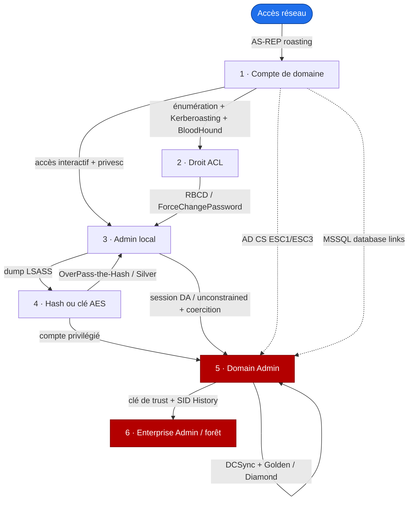

# Attack flow

> [!summary] Objectif
> L'attaque AD est une **machine à états** : on part de ce qu'on possède (un état) pour dériver ce qu'on peut en faire (les actions), et chaque action réussie fait changer d'état. Ce cours donne la carte ; les cheatsheets donnent les commandes. Révision : [[Flashcards - Attack flow]].

> [!tip] Comment lire cette page
> Repère ton **état courant** sur la carte → saute à la section numérotée correspondante → applique une action → tu changes d'état. Objectif final : remonter jusqu'à la forêt (Enterprise Admin).

## La carte

> [!tip] Carte interactive
> Version cliquable plein écran : [[Carte d'attaque.canvas|ouvrir la carte d'attaque]] — chaque état renvoie vers sa cheatsheet. Le schéma ci-dessous en est le résumé compact.

**Légende** — bleu : point d'entrée · rouge : objectifs (Domain / Enterprise Admin) · trait plein : progression directe · pointillé : raccourci (AD CS, MSSQL). Chaque flèche est détaillée dans la section de son état de départ.

## Le principe

Un état = ce que tu contrôles à l'instant T (rien, un compte, un droit, un accès admin, un hash, DA, EA). À chaque état correspond un jeu d'actions, et chaque action réussie te fait *changer d'état*. Progresser = enchaîner les transitions.

Le réflexe unique : **« qu'est-ce que je possède exactement, et vers quel nouvel acquis chaque option m'emmène ? »**

## Les états, dans l'ordre

### 0 · Accès réseau, aucun compte

**Tu possèdes :** une position réseau, éventuellement un nom d'utilisateur.

- **AS-REP roasting** (si un compte a la préauth désactivée) — *rapporte* un hash crackable offline. ([[Cheatsheet - AS-REP Roasting]])
- Sinon : obtenir une identité valide (creds trouvés, null session, phishing).

**Mène vers →** un compte de domaine (état 1).

### 1 · Compte de domaine

**Tu possèdes :** un compte authentifié — l'état de départ des labs (assume breach). AD est lisible par tout compte → énumérer largement d'abord.

- **Énumérer** users, groupes, ACL, GPO, trusts, sessions, AD CS, SQL — *rapporte* la carte du terrain. ([[Énumération AD]], [[Cheatsheet - Reconnaissance AD]])
- **Kerberoasting** d'un compte à SPN — *rapporte* un hash de service, souvent privilégié. ([[Cheatsheet - Kerberoasting]])
- **BloodHound** — *rapporte* le chemin le plus court vers Domain Admin. ([[Cheatsheet - BloodHound SharpHound]])

**Mène vers →** un droit ACL (état 2), un admin local (état 3), ou directement DA par une voie transverse.

### 2 · Un droit ACL sur un objet

**Tu possèdes :** un droit d'écriture sur un objet (repéré via BloodHound / [[Cheatsheet - ACL et droits AD]]).

- **ForceChangePassword** sur un user — *rapporte* le contrôle de ce compte.
- **GenericWrite / GenericAll** sur un computer — **RBCD** → *rapporte* un accès admin sur la machine. ([[Cheatsheet - RBCD]])
- **GenericWrite** sur un user — *rapporte* un targeted Kerberoasting (poser un SPN).
- Droit sur une **GPO** liée à une OU — *rapporte* l'exécution sur toutes ses machines. ([[Cheatsheet - GPO et OU]])

**Mène vers →** un compte, un admin local (état 3) ou un hash (état 4).

### 3 · Admin local sur une machine

**Tu possèdes :** des droits d'administration locaux sur un hôte.

- **Dumper les secrets** en mémoire (SafetyKatz) — *rapporte* les hash/clés des comptes connectés. ([[Cheatsheet - Post-exploitation]])
- **Chasser les sessions** — un DA connecté ici ? *rapporte* potentiellement des creds DA.
- Machine en **unconstrained delegation** + coercition d'un DC — *rapporte* le TGT du DC. ([[Cheatsheet - Delegation attacks]])

**Mène vers →** un hash / une clé (état 4), voire directement DA.

### 4 · Un hash ou une clé AES

**Tu possèdes :** le secret d'un compte (hash NT ou clé AES).

- **OverPass-the-Hash** — *rapporte* une session complète en tant que ce compte. ([[Cheatsheet - Lateral movement]])
- Compte de **service / machine** → **Silver Ticket** vers ses services. ([[Cheatsheet - Tickets Kerberos]])
- Compte **privilégié** → tu passes à l'état 5.

**Mène vers →** un mouvement latéral, ou Domain Admin (état 5).

### 5 · Domain Admin

**Tu possèdes :** le contrôle du domaine. Objectif : persister et franchir la forêt.

- **DCSync** — *rapporte* n'importe quel hash, dont `krbtgt`. ([[Cheatsheet - Persistence]])
- **Golden / Diamond Ticket** (avec `krbtgt`) — *rapporte* la re-domination à volonté. ([[Cheatsheet - Tickets Kerberos]])
- **DSRM** — *rapporte* un accès DC indépendant du domaine. ([[Cheatsheet - Persistence]])
- **Extraire la clé de trust** — prépare le franchissement (état 6).

**Mène vers →** Enterprise Admin / la forêt (état 6).

### 6 · Enterprise Admin (via un trust)

**Tu possèdes :** DA d'un domaine, et il existe un trust.

- Trust **enfant → parent** (intra-forêt) — forger un TGT inter-realm avec le SID des Enterprise Admins (SID History non filtré) → *rapporte* **Enterprise Admin**. ([[Cheatsheet - Trusts et forêts]])
- Trust **inter-forêt** — la clé de trust permet un referral ticket vers un service de l'autre forêt (SID History filtré par `FILTER_SIDS`).

**Objectif atteint :** domination de la forêt.

> [!note] Voies transverses : AD CS et MSSQL
> Deux raccourcis (flèches pointillées) qui court-circuitent la progression depuis un simple compte. **AD CS** (ESC1/ESC3) : Domain User → certificat au nom d'un DA → TGT DA/EA. ([[Cheatsheet - AD CS et certificats]]) **MSSQL** : compte de domaine accepté par une instance → crawl de database links → RCE cross-forest. ([[Cheatsheet - MSSQL et PowerUpSQL]])

## Notes associées

- [[Flashcards - Attack flow]]
- [[Flashcards - MOC]]
- [[1. Cheatsheet - Toutes les commandes]]
- [[Checklist - Méthodologie CRTP]]
