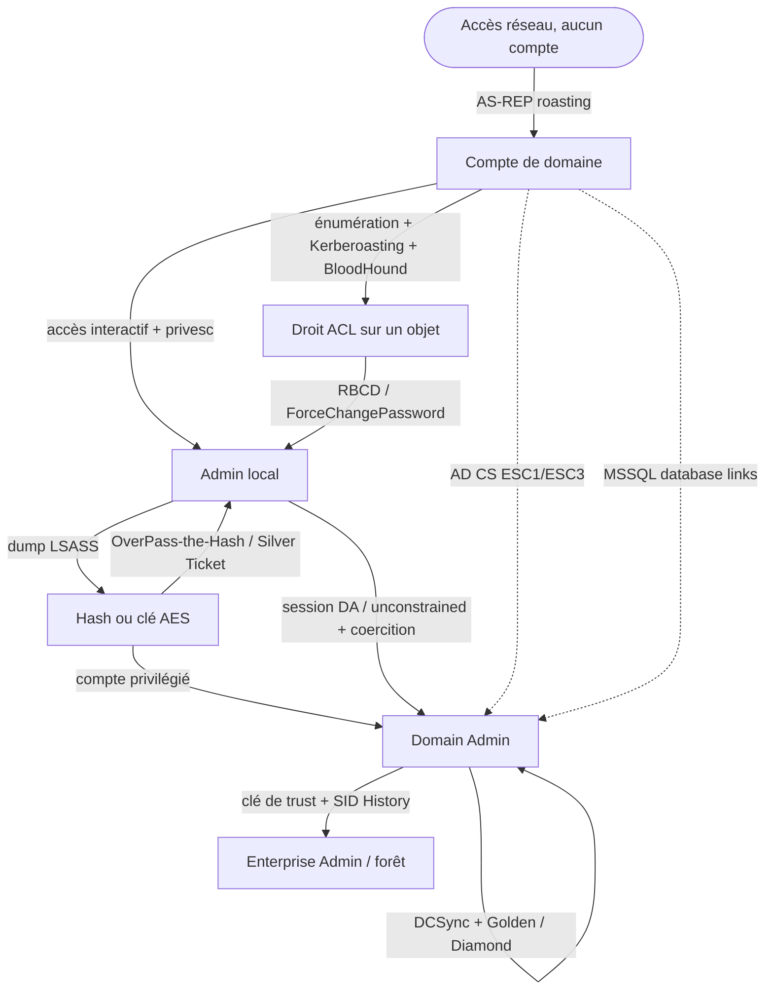

# Attack flow

> [!summary] Objectif
> Chemin de réflexion offensif : au lieu de mémoriser des attaques isolées, on part de **ce qu'on possède** (un état) pour dériver **ce qu'on peut en faire** (les actions), sachant que chaque action produit un nouvel acquis. L'attaque AD est une machine à états — ce cours donne la carte, les cheatsheets donnent les commandes. Révision : [[Flashcards - Attack flow]].

## Vue d'ensemble

Chaque flèche est une transition détaillée plus bas : à gauche l'état que tu possèdes, sur la flèche l'action, à droite le nouvel acquis.

## Le principe

Un état = ce que tu contrôles à l'instant T (rien, un compte, un hash, un droit, un accès admin, DA, EA). À chaque état correspond un jeu d'actions possibles, et chaque action réussie te fait *changer d'état*. Progresser = enchaîner les transitions jusqu'à la domination de la forêt.

Toujours se demander : **« qu'est-ce que je possède exactement, et vers quel nouvel acquis chaque option m'emmène ? »**

## Tu as : un accès réseau, aucun compte

- Un **nom d'utilisateur** sans préauth → **AS-REP roasting** → *rapporte* un hash crackable ([[Cheatsheet - AS-REP Roasting]]).
- Rien d'autre d'exploitable tant que tu n'as pas d'identité valide. Objectif immédiat : obtenir un compte de domaine (phishing, creds trouvés, null session).

## Tu as : un compte de domaine (assume breach)

C'est l'état de départ des labs. AD est lisible par tout compte authentifié → énumérer largement.

- **Énumérer** (users, groupes, ACL, GPO, trusts, sessions, ADCS, SQL) → *rapporte* la carte du terrain ([[Enumeration]], [[Cheatsheet - Reconnaissance AD]]).
- **Kerberoasting** d'un compte à SPN → *rapporte* un hash de compte de service, souvent privilégié ([[Cheatsheet - Kerberoasting]]).
- **BloodHound** → *rapporte* un chemin visuel vers Domain Admin ([[Cheatsheet - BloodHound SharpHound]]).
- **Droit ACL intéressant** repéré (GenericWrite, WriteDACL, ForceChangePassword) → voir l'état « tu as un droit ACL ».
- **Privesc locale** si tu as un accès interactif sur une machine → voir « admin local ».

## Tu as : un droit ACL sur un objet

- `ForceChangePassword` sur un user → réinitialiser son mot de passe → *rapporte* ce compte.
- `GenericWrite`/`GenericAll` sur un **computer** → **RBCD** → *rapporte* un accès admin sur cette machine ([[Cheatsheet - RBCD]]).
- `GenericWrite` sur un user → **targeted Kerberoasting** (poser un SPN) ou forcer un logon.
- Droit sur une **GPO** liée à une OU → exécution/config sur toutes les machines de l'OU ([[Cheatsheet - GPO et OU]]).

## Tu as : un admin local sur une machine

- **Dumper les secrets** en mémoire (SafetyKatz) → *rapporte* les hash/clés des comptes connectés ([[Cheatsheet - Post-exploitation]]).
- **Chasser les sessions** : un DA connecté ici ? → *rapporte* potentiellement des creds DA.
- Machine en **unconstrained delegation** → capturer les TGT + coercition du DC → *rapporte* le TGT du DC ([[Cheatsheet - Delegation attacks]]).

## Tu as : un hash / une clé AES d'un compte

- **OverPass-the-Hash** → *rapporte* une session complète en tant que ce compte ([[Cheatsheet - Lateral movement]]).
- Si c'est un **compte de service/machine** → **Silver Ticket** vers ses services ([[Cheatsheet - Tickets Kerberos]]).
- Si le compte est privilégié → tu changes d'état vers « DA ».

## Tu as : Domain Admin

- **DCSync** → *rapporte* n'importe quel hash du domaine, dont `krbtgt` ([[Cheatsheet - Persistence]]).
- Avec `krbtgt` → **Golden / Diamond Ticket** → persistance et re-domination à volonté ([[Cheatsheet - Tickets Kerberos]]).
- **DSRM** → *rapporte* un accès DC indépendant du domaine ([[Cheatsheet - Persistence]]).
- **Extraire la clé de trust** → voir « franchir un trust ».

## Tu as : DA d'un domaine, il existe un trust

- Trust **enfant → parent** (intra-forêt) : forger un TGT inter-realm avec SID History (SID des Enterprise Admins) → *rapporte* **Enterprise Admin** ([[Cheatsheet - Trusts et forêts]]).
- Trust **inter-forêt** : la clé de trust permet un referral ticket vers un service de l'autre forêt (SID History filtré par `FILTER_SIDS`).

> [!note] Voie parallèle : AD CS et MSSQL
> Deux chemins qui court-circuitent souvent la progression classique. **AD CS** (ESC1/ESC3) : un simple Domain User → certificat au nom d'un DA → TGT DA/EA ([[Cheatsheet - AD CS et certificats]]). **MSSQL** : un compte de domaine accepté par une instance SQL → crawl de database links → RCE cross-forest ([[Cheatsheet - MSSQL et PowerUpSQL]]).

## Notes associées
- [[Flashcards - Attack flow]] · [[1. Cheatsheet - Toutes les commandes]] · [[Checklist - Méthodologie CRTP]]
